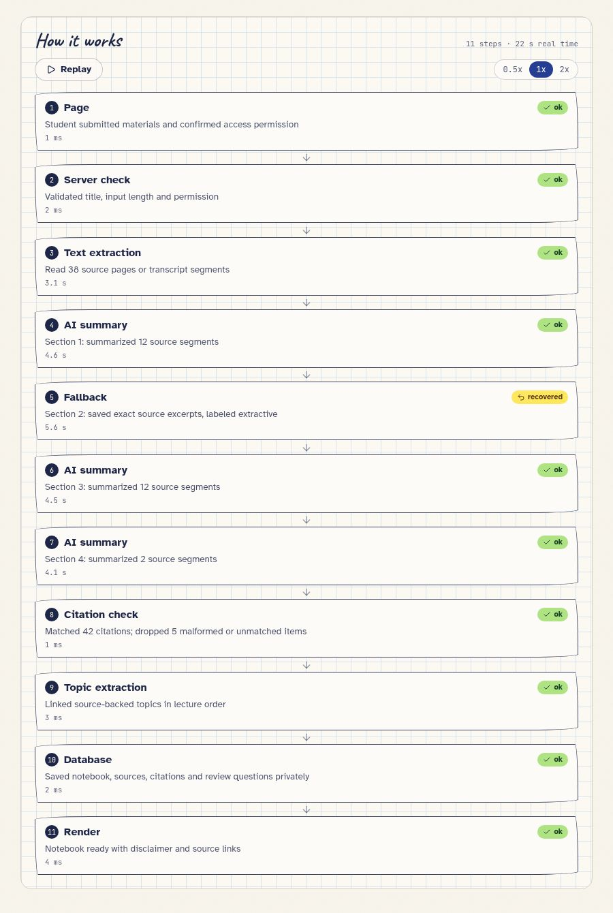

# Proxie

Proxie turns lecture materials a student is allowed to use into a private, source-cited study notebook and a visual course learning path. It does **not** record live lectures or present learning progress as an official grade.

## What it does

- Builds notebooks from text PDFs, pasted transcripts, or saved course materials.
- Keeps source-slide or transcript-line/timestamp citations beside notes, terms, and diagrams.
- Lets students flag a cited statement, edit a section, or regenerate that section from its sources.
- Shows a game-inspired **honeycomb skill tree** with Locked, Unlocked, Practicing, and Mastered topics.
- Supports placement questions, spaced review, evidence-based XP, quests, badges, and pausable streaks.
- Replays the actual build/flag/fix events at 0.5×, 1×, or 2× speed without slowing the real build.
- Formats pseudocode as code rather than flattened prose, retaining the original text when indentation must be inferred.
- Offers a public **Example workspace** with a separate temporary practice copy for each visitor—no sign-up or shared student login.

**Accuracy boundary:** matching a quotation proves that the quotation appears in the source, not that the AI's interpretation is correct. Students must check citations. Direct edits keep original source references and are explicitly not AI-verified.

## How it works — a real run

The screenshot below shows the recorded processing steps from a real upload of the supplied **CSE 421 Lecture 17: The max flow and min cut problems** PDF, not simulated progress or seeded demo events.

The 38-page lecture completed in approximately **22 seconds**, with **11 recorded steps**. Three source groups received AI summaries; one group used the explicitly labeled **extractive fallback**. The citation check matched **42 citations** and dropped **5 malformed or unmatched items**. These checks verify source-quote matches, not the correctness of every interpretation.



Only the processing diagram is included here. The lecture PDF, generated lecture notes, account identity, and credentials are not included in this screenshot or documentation addition. Timings and outcomes are specific to this run.

## Getting started

This is a **pnpm monorepo**, not a static-only website. Use Node.js 24 and pnpm 10.26.1.

```sh
corepack enable
pnpm install --frozen-lockfile
pnpm run typecheck
pnpm run test:unit
```

For setup and running services, read **[Setup](docs/SETUP.md)** before adding credentials or running database commands. The placeholder-only [environment example](.env.example) is not a working configuration.

### Replit

Use the existing managed workflows:

- `artifacts/proxie: web` — React frontend.
- `artifacts/api-server: API Server` — Express API.
- The component-preview workflow is design tooling, not the student application.

The frontend uses `/`, the API uses `/api`, and production Clerk proxy requests use `/api/__clerk`. Keep the browser and API on the same public origin. Use Replit's Auth, Database, App Storage, and Secrets facilities; do not copy live keys into files or GitHub.

### Checks

```sh
pnpm run typecheck
pnpm run test:unit
# Uses and cleans up randomized fixtures in a configured DEVELOPMENT database:
pnpm run test:isolation
# Supply service build variables when building outside managed workflows:
PORT=5000 BASE_PATH=/ pnpm run build
```

Never run the isolation suite against production. It tests account isolation with injected test identities, not actual Clerk sign-in sessions.

## Documentation

- [Setup and configuration](docs/SETUP.md)
- [Architecture and data boundaries](docs/ARCHITECTURE.md)
- [Maintenance, backups, and incidents](docs/OPERATIONS.md)
- [Costs and realistic free-use options](docs/COSTS.md)
- [Original-plan compliance and known gaps](docs/PLAN-COMPLIANCE.md)
- [Security review and verification record](docs/SECURITY-REVIEW.md)
- [Reporting a security issue](SECURITY.md)

## Important operating limits

- PDF extraction: at most **15 MiB, 100 pages**; combined source text: **120,000 characters**.
- A scanned PDF without extractable text needs a transcript; there is no OCR or live recording.
- Each account can request **20 builds/regenerations per UTC day**. Failed attempts also consume the allowance; viewing, quizzes, and manual edits do not. This is an abuse guard, **not** a global AI spending cap.
- The shared editable judge account is **development-only**, uses fictional material, and must not hold private student data.
- The public **Example workspace** uses isolated, fictional in-memory data that expires after two hours or a server restart. It supports citations, flags, manual edits, quizzes, progress, and the honeycomb tree. Uploads, new-course/notebook builds, and AI regeneration require a personal account and are blocked server-side for examples. See [Example workspace](docs/EXAMPLE-WORKSPACE.md).
- Keep a **single active API instance** with this implementation. Jobs run in process; startup recovery is not a distributed job queue.
- Signed upload links expire after 15 minutes. The extraction limit is checked after upload; storage-level upload quotas and orphan cleanup remain hardening work.
- GitHub stores code. It does **not** include student data, managed service credentials, or a running backend/database.

## Security and release status

The documented security review found no remaining automated scanner findings after dependency updates. That is not a guarantee of security or complete product correctness. Review the [remaining risks and untested paths](docs/SECURITY-REVIEW.md) before opening public registration or using sensitive materials.

This repository does not configure paid services or publish the site automatically. Check [costs](docs/COSTS.md) before running it. Provider free tiers can change or expire.

## Licensing

The existing package metadata declares MIT. Before publishing or redistributing publicly, the owner should confirm the intended license and add the corresponding `LICENSE` file. Third-party dependency licenses still apply.
